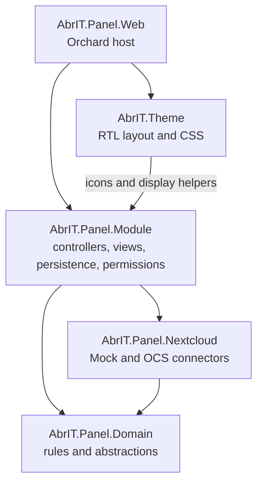
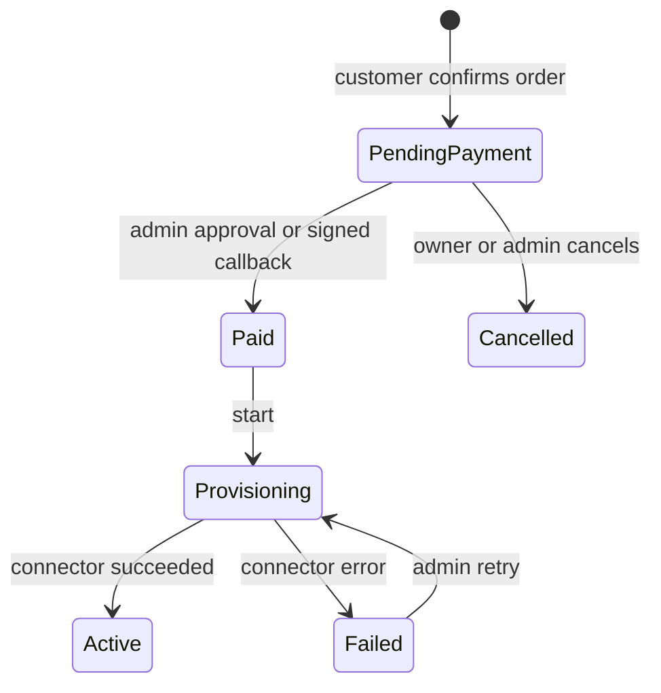

# Architecture

One Orchard Core application. There is no separate front-end: pages are server-rendered Razor views.

## Projects

| Project | Responsibility |
|---|---|
| `Domain` | Order state machine, order, payment approval, provisioning and team services, interfaces. No Orchard or ASP.NET references, so the rule tests are fast and need no I/O ([D-05](DECISIONS.md)). |
| `Nextcloud` | `MockNextcloudProvisioner` and `OcsNextcloudProvisioner` behind `INextcloudProvisioner`. `Nextcloud:Mode` picks one at startup. |
| `Module` | MVC controllers, views, admin menu, permissions, YesSql repositories, indexes and migrations, adapters for Orchard's lock, ids and users, the setup recipe. |
| `Theme` | `dir="rtl"` layout, CSS, self-hosted Vazirmatn, design tokens from `design-system/tokens.css`. Signed-in pages get a navy sidebar (`--abr-side-*` tokens); anonymous pages render no sidebar. |
| `Web` | Host, configuration validation, e-mail pickup fallback, `/health/live`. `dotnet run` uses the `Local` environment for zero-touch setup ([D-28](DECISIONS.md)). |

Orchard Core's source is not modified. Users, roles, registration, password reset, content editing, recipes, e-mail
and distributed locks are Orchard's own.

## Data

| Data | Storage | Reason |
|---|---|---|
| Services and plans | Orchard content items (`AbrService`, `AbrPlan`) | Editorial: admins edit them without a deploy |
| `Order`, `ProvisioningRequest`, `TeamWorkspace` | YesSql documents with map indexes | Strict state, ownership and concurrency rules; must not be editable in the generic content editor |

An order stores a **snapshot** of its plan, so later catalog edits do not change existing orders.

## Order flow: from order to Active

1. **Order.** `OrderService.PlaceOrderAsync` checks that the plan can be ordered, copies its snapshot, assigns an
   order number and saves the order as `PendingPayment`.
2. **Payment (simulated).** The admin button (permission `ApproveTestPayments`) or the HMAC-signed callback calls
   `PaymentApprovalService`. Approving an order that is already paid changes nothing and returns the current state.
3. **Provisioning.** `ProvisioningService.ProvisionAsync` takes the per-order lock, finds or creates the single
   `ProvisioningRequest`, saves `InProgress`, and only then calls the connector: ensure the user exists, set the quota
   and, for the Team plan, ensure the group and add the owner.
4. **Result.** Success gives `Active`. An error gives `Failed` and stores a sanitised error code.
5. **Retry.** Admin only, only from `Failed`, at most 5 attempts.

It runs synchronously inside the approval request ([A-01](DECISIONS.md)). While an order is `Paid` or `Provisioning`,
the customer's order page reloads itself every few seconds; it does not reload while a form field is in use. In every other state it does not reload.

## No duplicate service: three layers

1. **State machine:** only a `Paid` order starts provisioning, and only `Failed` can be retried. Any other transition
   throws.
2. **One request per order,** created and changed only inside the per-order lock (Orchard `IDistributedLock`). State is
   committed before the lock is released ([D-12](DECISIONS.md)).
3. **Deterministic external id** derived from the order number ([A-06](DECISIONS.md)) with create-if-missing at the
   connector. In OCS, status 102 ("already exists") counts as success.

The OCS client also retries one transient HTTP failure. That is safe because of layer 3, and is separate from the
admin retry.

## Security boundaries

- Customers can only read orders where `OwnerUserId` is their own. Anyone else's order returns **404**.
- Admin actions are checked in the controller **and** again in the domain service ([D-13](DECISIONS.md)).
- All form posts require an antiforgery token. The callback endpoint instead requires a valid HMAC signature and is
  off without a secret.
- Connector errors are reduced to fixed codes before they are stored. Exception messages, URLs and credentials are not
  stored or shown.
- The Nextcloud app password comes from environment variables or user-secrets. The panel never keeps a customer's
  Drive password.
- The UI says when an activation is Mock and never presents it as a real account.

## Tests

| Layer | What it proves |
|---|---|
| `Domain.Tests` (115) | State machine, ownership, idempotency, retry, team seats |
| `Nextcloud.Tests` (39) | Mock behaviour; OCS headers, status-code mapping, retry and secret hygiene against a **fake HTTP handler** |
| `Web.Tests` (19) | The real Orchard host over HTTP on a temporary SQLite database: AC-01 to AC-09, including a restart |
